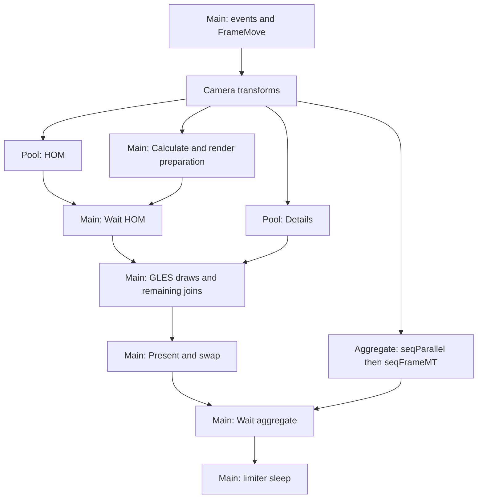

# Выполнение кадра: CPU, jobs, GLES и ожидания

D3,23–24.10.2026. Карта конкретного Android/GLES форка, **не измеренный timing diagram**. Обозначение main — native SDLThread, UI — Android Looper, aggregate — одна последовательная task, не отдельный гарантированный OS thread. Источники: [device.cpp][device], [render notes][render], [gameplay notes][game].

## Нормальный загруженный игровой кадр

| Порядок | Работа | Thread/lane и shared data | Тип затрат / barrier |
|---|---|---|---|
| 0 | SDL lifecycle/input/window events, CApplication loop | Native main; Java UI производит входные события | Event waits/dispatch отдельно от игрового кадра. Background drain/наличие context определяет разрешение render. |
| 1 | BeforeFrame | Main: readiness/loading events | Sleep100 при !ready; loading callback+LoadDraw может завершить iteration без normal gameplay. |
| 2 | FrameMove→seqFrame | Main: time, scheduler, objects, AI, Lua, default physics, sound update | Реальные вычисления и возможные mutex/IO внутри; prior aggregate barrier уже пройден в конце предыдущего кадра. |
| 3 | OnCameraUpdated | Main публикует transforms; renderer dispatch HOM и Details | CPU jobs могут стартовать сразу. Нужные immutable inputs не полностью отделены от globals. |
| 4 | AddTask(processSeqParallel) | Pool/caller: delegates по одному, затем seqFrameMT | Перекрывается с main rendering; serial order delegates сохраняет часть зависимости world state. |
| 5 | DoRender→RenderBegin→seqRender→Calculate | Main GL owner: sector, SSA, light/spatial work, Wait(HOM), dispatch main/rain/sun prep | Wait может исполнять jobs. GPU не измеряется этим CPU wall scope. |
| 6 | Render | Main GLES commands + CPU preparation jobs | r_main.sync, Detail Wait, r_rain.sync/r_sun.sync, light batch Wait до consumption. Geometry/HUD/details→lights/shadows→combine/postprocess. |
| 7 | Statistics/ImGui, вход RenderEnd→GEnv.Render->End | Main GL owner | CPU UI draw preparation и bookkeeping. Present следующей строки вложен внутрь End, а не отдельный поздний вызов. |
| 8 | Вложенный CHW::Present, затем возврат в RenderEnd | Main: FBO blit→SDL_GL_SwapWindow→selected eglSwapBuffers; после возврата сохраняются camera position/direction/matrices | Driver CPU + возможный GPU/compositor/buffer-queue wait. Длительный swap не равен CPU-bound вычислению. Saved camera state обновляется **после** Present. |
| 9 | Wait(processSeqParallel) | Main помогает pool и/или активно опрашивает completion | Это **после Present**; не все фоновые задачи обязаны завершиться до показа кадра. Completion/lifetime defects D2 остаются. |
| 10 | FPS limiter / inactive Sleep | Main; updateDelta=1000/cap, TimerGlobal | Ограничение cadence/OS sleep, не вычисление и не GPU time. Unlock обходит gameplay limiter; menu policy отдельно. |

Точные вызовы: [ProcessFrame:972][device], [aggregate:1036][aggregate], [FrameMove:1266][framemove], [Calculate:67][calculate], [Render:95][r_render], [Present:560][present].

Диаграмма показывает существующие крупные joins, **не утверждает полноту синхронизации**. В частности, Details читает HOM/SSA до своей стрелки join в main; edge H→D сейчас отсутствует. Early reset/loading paths могут обходить обычные joins. [Source dependency model][deps], [независимое review][review].

## Подготовка рендера и owner GL

GLES вариант принудительно ставит o.mt_render=0; остаётся CPU-side task preparation. Main/sun/rain/light phase preparation выполняется через queue **или inline** по mt_calc/oldshadow/ZFILL и конкретной фазе; HOM/Details dispatch при активном мире не отключается r2_mt_calculate. Main/sun/light graph maps/cascade snapshots частично отдельные, но visual markers, live spatial state, CBackend caches и общие RNG/SSA требуют строгого владения. Disabled static traversal #if0 прямо требует разделения maps. CPU context IDs нельзя трактовать как shared EGL contexts или Vulkan command buffers. [r2_R_calculate.cpp][calculate], [render job table][render].

Native: GLAD→native GLES/EGL vendor driver. ANGLE: тот же main GLES stream→ANGLE validation/state/translation→Vulkan command buffers/queue→Vulkan driver. Pinned ANGLE-GC recycling thread не делает X-Ray simulation/culling параллельными автоматически; shader/internal workers зависят от feature/runtime. Runtime worker CPU costs обоих driver путей неизвестны. [Pinned-source audit][render].

## Пять разных значений времени

1. **Elapsed stage**: от начала до конца функции; включает sleep, ожидания, драйвер и выполнение чужой task внутри Wait.
2. **Thread CPU**: только время, когда данный OS thread исполнялся; оно может включать пустой spin и driver CPU, а не только полезную игровую логику.
3. **Running/runnable/sleeping**: scheduler trace отличает выполнение от ожидания CPU и блокировки. S/D сами по себе не определяют причину.
4. **GPU elapsed**: неблокирующие timestamp queries отдельной GPU timeline; не utilization/полная энергия и не сумма вложенных scopes.
5. **Presented interval**: время между реально представленными frames; зависит от compositor/display и не равно CPU/GPU stage duration.

Это разграничение реализуемо через [план Perfetto и scopes][profiling]. Старые GPU JSONL покрывают render scope, а android_perf FrameMove/TaskWait — elapsed; полная per-thread critical-path трасса пока отсутствует. [Исторические данные][history].

## Синхронизация и исключения

| Место | Фактическое поведение | Ошибочный вывод, которого избегаем |
|---|---|---|
| TaskManager::Wait | ExecuteOneTask в loop; primary может выполнять чужую task; completion сейчас relaxed | Всё TaskWait wall — не idle, не обязательно futex и не неизбежный driver stall. |
| Worker idle | TaskWorkerStart паркуется на Event, если нет работы | Нельзя считать весь pool непрерывно spinning. |
| Global frame fence | R_sync_point::Wait вызывает fence/client wait в fallback; stream upload/sync bypass его пропускает | Нельзя обвинять этот fence без effective args. Старый unsafe stream_orphan не включать. |
| Stream upload | CPU staging/BufferSubData вместо unsynchronized overwrites; other map пути могут блокироваться | Сохранность данных не означает нулевую driver cost. |
| Occlusion polling | Имеет polling/yield/sleep, но GL -occq opt-in, default off | Disabled path не доказанный bottleneck текущего запуска. |
| Skeleton lock | CalculateBones содержит один глобальный mutex и callbacks | Добавление workers вокруг функции не означает параллельный расчёт костей. |
| Limiter | Integer ms; cap60→16ms; paused/scaled TimerGlobal отдельно | «60» в config не гарантирует60 present FPS или16.6667ms schedule. |
| Swap | SDL→EGL может ждать display queue/driver | Время swap нельзя объявлять CPU workload без scheduler+stack evidence. |

Источники: [Wait][wait], [render waits][render], [bones/gameplay][game], [старый pacer audit][pacer]. Существующий standalone pacer не повторно реализован и не включён.

## Что требуется добавить в будущую диагностику

Frame ID + monotonic timestamps/PID/TID/session, scopes main update/physics/AI/Lua/animation, aggregate delegates, HOM/detail cache/visibility, prep, waits, GL upload/submission, swap, limiter. У Wait отдельно считать полезное исполнение tasks и пустые итерации; у workers — task counts/body duration/high-water. При fixed clock/weather сохранять gameplay cadence. Буферизовать запись, не flush/trace каждый vertex/task. Observer-off контроль обязателен. Это **план**, не instrumented production code. [Profiling plan][profiling].

[device]: C:/Users/User/Documents/Codex/2026-10-11/gjvyb/work/openxray-build/src/xrEngine/device.cpp:972
[aggregate]: C:/Users/User/Documents/Codex/2026-10-11/gjvyb/work/openxray-build/src/xrEngine/device.cpp:1036
[framemove]: C:/Users/User/Documents/Codex/2026-10-11/gjvyb/work/openxray-build/src/xrEngine/device.cpp:1266
[calculate]: C:/Users/User/Documents/Codex/2026-10-11/gjvyb/work/openxray-build/src/Layers/xrRender_R2/r2_R_calculate.cpp:67
[r_render]: C:/Users/User/Documents/Codex/2026-10-11/gjvyb/work/openxray-build/src/Layers/xrRender_R2/r2_R_render.cpp:95
[present]: C:/Users/User/Documents/Codex/2026-10-11/gjvyb/work/openxray-build/src/Layers/xrRenderGL/glHW.cpp:560
[wait]: C:/Users/User/Documents/Codex/2026-10-11/gjvyb/work/openxray-build/src/xrCore/Threading/TaskManager.cpp:316
[render]: C:/Users/User/Documents/Codex/2026-10-11/gjvyb/work/threading-cpu-20261023/render/RENDER_THREADING_NOTES.md
[game]: C:/Users/User/Documents/Codex/2026-10-11/gjvyb/work/threading-cpu-20261023/gameplay/GAMEPLAY_THREADING_NOTES.md
[deps]: C:/Users/User/Documents/Codex/2026-10-11/gjvyb/work/threading-cpu-20261023/render/render-dependency-model.json
[review]: C:/Users/User/Documents/Codex/2026-10-11/gjvyb/work/threading-cpu-20261023/review-render-findings.md
[profiling]: C:/Users/User/Documents/Codex/2026-10-11/gjvyb/work/openxray-build/ANDROID_CPU_PROFILING_PLAN.md
[history]: C:/Users/User/Documents/Codex/2026-10-11/gjvyb/work/threading-cpu-20261023/historical-evidence-index.json
[pacer]: C:/Users/User/Documents/Codex/2026-10-11/gjvyb/work/thermal-power-20261023/pacing/audit.md
